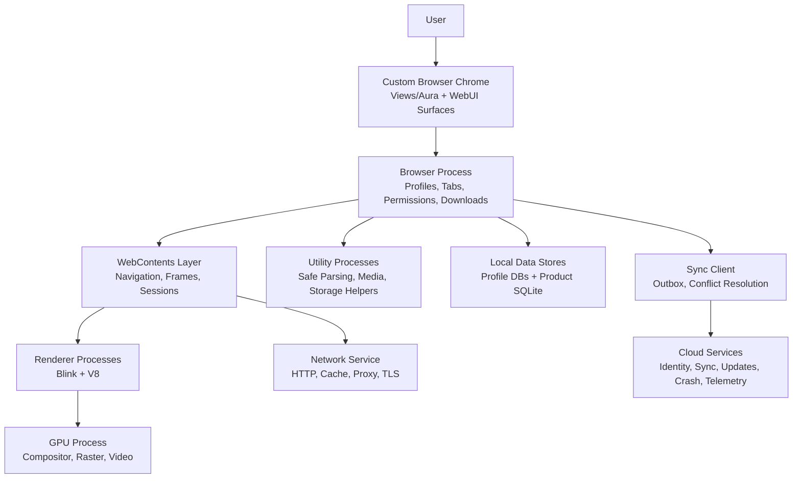
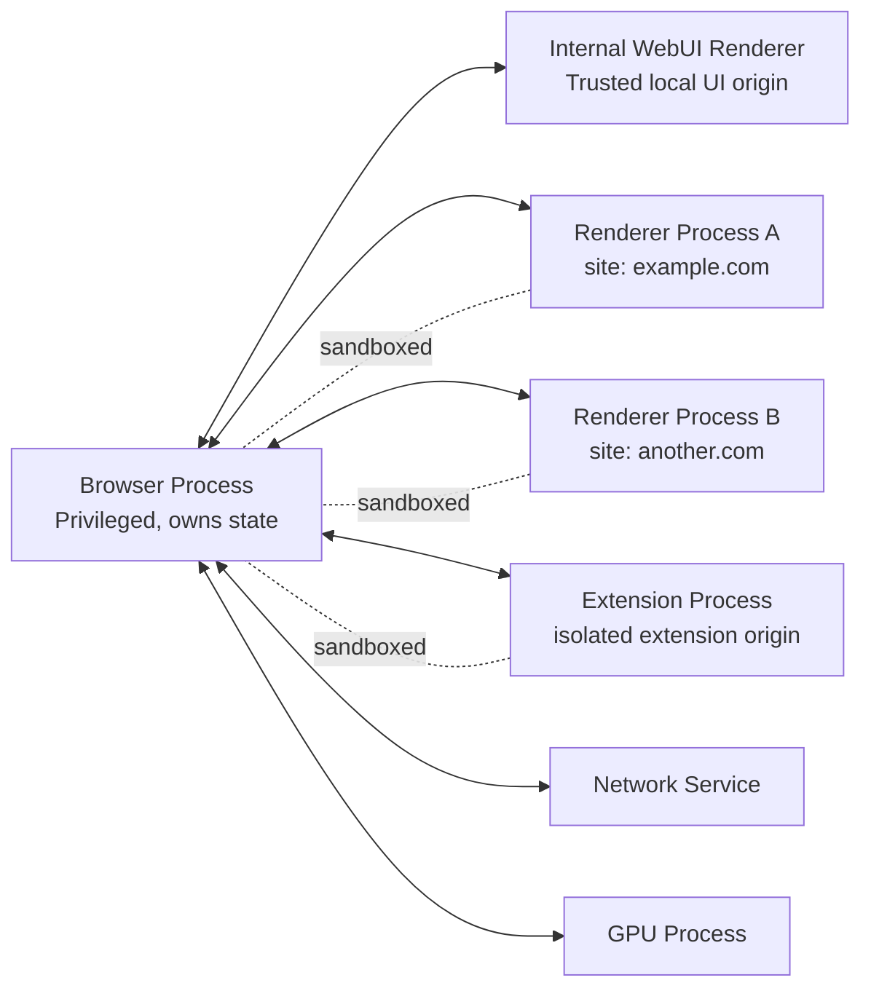
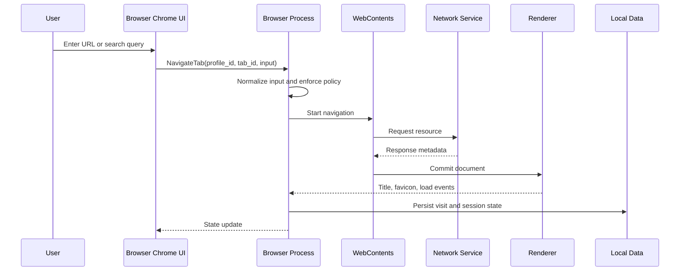
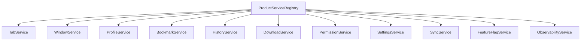
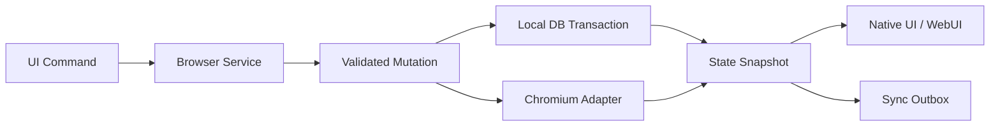
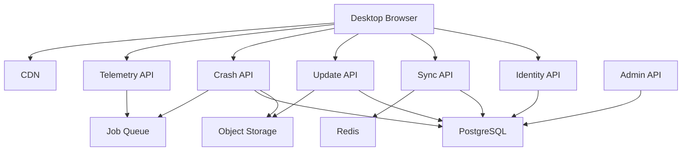
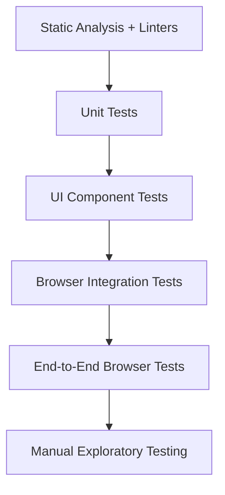
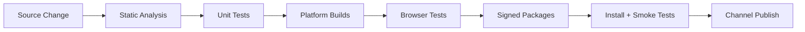

# Greenfield Chromium Browser Platform Plan

> **For agentic workers:** REQUIRED SUB-SKILL: Use `superpowers:subagent-driven-development` or `superpowers:executing-plans` before implementing this plan task-by-task. This document is a greenfield target-system architecture blueprint.

**Goal:** Build a production-grade desktop browser platform with a custom product identity, deep Chromium engine control, secure multi-process browsing, first-class local state, and optional cloud sync.

**Architecture:** The product is a direct Chromium fork with a native browser-process core, strict upstream patch discipline, custom browser chrome, internal WebUI surfaces, and optional backend services for identity, sync, updates, telemetry, and crash handling. Chromium remains the authority for rendering, network loading, site isolation, sandboxing, storage partitioning, permissions primitives, and WebContents lifecycle.

**Tech Stack:** Chromium, Blink, V8, C++20, Chromium Views/Aura, Mojo, TypeScript, Svelte 5 for rich internal WebUI surfaces, Rust for optional side services and backend workers, PostgreSQL, SQLite, Redis, S3-compatible object storage, OpenTelemetry, Crashpad, GN, Ninja/Siso, depot_tools.

---

## Critical Architecture Review

### Core Question

Is a direct Chromium fork with custom browser chrome and deep browser-process control the best architectural choice for this project?

### Conclusion

The architecture is sound only if the product genuinely requires modifications to Blink, V8, browser-process policy, WebContents lifecycle, network behavior, security policy, extension behavior, or site isolation rules. Under that requirement, a direct Chromium fork is the correct strategic choice. It avoids fighting embedding abstractions and gives the team access to the real browser platform.

For a browser whose goal is only custom UI, tabs, bookmarks, history, downloads, and normal browsing, this architecture would be too expensive. CEF, Qt WebEngine, or Electron would provide faster development with lower maintenance cost. Because the stated requirement is deep engine and browser-process control, those alternatives become constraints rather than accelerators.

Final recommendation: proceed with a direct Chromium fork, but minimize divergence from upstream Chromium. Treat every fork-specific change as a patch with an owner, tests, security review, upstream rebase strategy, and removal criteria.

### Advantages

- Full control over Chromium browser-process behavior, WebContents lifecycle, profile storage policy, permissions, navigation handling, extension policy, network stack configuration, feature flags, Blink runtime features, and V8 behavior.
- Access to Chromium's mature multi-process model, sandboxing, Site Isolation, GPU process, network service, storage partitioning, media pipeline, accessibility stack, DevTools protocol, and Web Platform Tests.
- Ability to ship a real browser rather than a browser-like application shell.
- Ability to integrate custom UI deeply with tabs, omnibox, permissions prompts, downloads, profiles, extensions, history, and security indicators.
- Ability to define product-specific privacy, sync, AI, search, and automation features at browser depth.
- Ability to keep remote web content in Chromium's normal isolated renderer model instead of inventing unsafe embedding patterns.

### Disadvantages

- Very high maintenance burden. Chromium changes continuously, and security updates must be absorbed quickly.
- Build complexity is significant. Engineers need high-end machines or remote build infrastructure, plus familiarity with depot_tools, GN, Ninja/Siso, Chromium code search, and Chromium test suites.
- Product UI development is slower than a normal web app because critical browser chrome must integrate with native Chromium windowing, focus, accelerators, accessibility, profile state, and WebContents ownership.
- Cross-platform behavior requires continuous validation on Windows, macOS, and Linux. Native UI, sandboxing, GPU, media, fonts, accessibility, and update flows differ by platform.
- Security responsibility is substantial. The team inherits the obligation to preserve Chromium's sandbox, Site Isolation, process model, permission boundaries, update integrity, and safe handling of untrusted content.
- Fork divergence can become unmanageable if product changes are scattered across Chromium internals.

### Trade-Offs

| Decision | Benefit | Cost | Mitigation |
| --- | --- | --- | --- |
| Direct Chromium fork | Maximum browser control | Highest maintenance cost | Patch queue discipline, upstream rebase cadence, minimal invasive changes |
| Native C++ browser chrome for critical surfaces | Strong integration with focus, tabs, permissions, accessibility, and WebContents | Slower design iteration than pure web UI | Use design tokens, component inventory, and WebUI for rich non-critical surfaces |
| Svelte 5 for internal WebUI pages | Fast UI iteration for settings, history, downloads, profiles, command palette | Requires Chromium WebUI integration and strict security boundaries | Use local trusted origins, CSP, typed IPC, and no remote script execution |
| Rust side services | Memory safety for sync, indexing, local intelligence, and backend workers | FFI and packaging complexity | Keep Rust outside Chromium critical path unless clearly justified |
| Cloud sync backend | Multi-device value | Identity, conflict resolution, privacy, and operational complexity | Make cloud optional, encrypt sensitive records, support offline-first local operation |
| Custom engine patches | Product differentiation | Security and rebase risk | Require ADR, test coverage, owner, and rollback path for every engine patch |

### Long-Term Maintainability

Maintainability depends less on the initial implementation and more on patch governance. A direct Chromium fork can remain maintainable if the team:

- Tracks Chromium stable releases and security patches aggressively.
- Keeps fork patches small, documented, tested, and owned.
- Avoids editing Blink, V8, network service, sandbox, and process model unless the product requirement cannot be achieved at a higher layer.
- Builds product features through extension points, feature flags, services, WebUI surfaces, and browser-process adapters before modifying lower-level engine code.
- Maintains a rebase dashboard that shows patch conflicts, test failures, security deltas, and release blockers.

This architecture becomes unmaintainable if the team treats Chromium as normal application code and freely modifies internals without ownership boundaries.

### Scalability Implications

Desktop scalability is primarily about process count, memory pressure, tab lifecycle management, cache policy, session restore, startup path, and GPU stability. Chromium provides strong foundations, but custom features must not break process isolation or create global browser-process bottlenecks.

Cloud scalability is bounded by sync volume, telemetry volume, crash dump ingestion, update bandwidth, and account services. The backend must be designed as optional infrastructure, not as a runtime dependency for normal browsing.

### Performance Implications

Performance is strong if the architecture preserves Chromium's native rendering pipeline, compositor, GPU process, HTTP cache, resource scheduler, and Site Isolation model. Performance degrades if custom UI or sync code blocks the browser UI thread, if engine patches increase renderer memory, or if internal WebUI surfaces over-render large browser state.

The browser must budget performance across:

- Startup and first-window time.
- New-tab creation time.
- Omnibox input latency.
- Navigation commit latency.
- UI frame time under tab churn.
- Memory per tab and per process.
- Sync CPU and disk I/O.
- Crash recovery and session restore time.

### Developer Experience

The developer experience is difficult but manageable with strong tooling:

- Provide one-command environment bootstrap scripts per platform.
- Provide remote build cache and distributed builds.
- Maintain a small set of documented build targets.
- Keep product code isolated in named top-level directories or patch-owned modules where possible.
- Provide architectural maps for Chromium integration points.
- Require test commands that do not need a full browser rebuild for every product-level change.

Without this investment, onboarding and iteration will be slow enough to damage the project.

### Deployment Complexity

Deployment is materially harder than normal desktop software:

- Binaries are large.
- Platform signing requirements are strict.
- Auto-update must be secure, resumable, rollback-aware, and channel-aware.
- Proprietary codec choices may affect distribution.
- Crash reporting and symbol handling require dedicated infrastructure.
- Security patch releases must be shipped quickly.

The release system must be designed from the beginning, not added after the first public build.

### Alternative Architectures Considered

#### CEF-Based Browser Shell

CEF is a strong option for embedding Chromium in a custom application. It is better for a custom shell that does not require deep Blink, V8, or Chromium browser-process changes. It is rejected as the primary architecture because the requirement includes deep browser-process and engine control. CEF would force the team to carry patches through an extra embedding layer.

#### Electron-Based Browser Shell

Electron is excellent for custom desktop application UI, but it is not a good foundation for a browser-engine fork. Electron's browser abstractions, process model, and webview recommendations constrain deep browser behavior. Electron is rejected because it optimizes app development, not browser ownership.

#### Tauri/System-WebView Browser Shell

Tauri is lightweight and useful for desktop applications, but system webviews are not a controllable browser engine. Cross-platform engine behavior differs by operating system. Tauri is rejected because the project requires consistent engine ownership.

#### Qt WebEngine

Qt WebEngine is based on Chromium and provides good native application integration. It is rejected because it adds another framework release cycle and limits direct control over Chromium internals.

#### Gecko/Firefox Fork

Gecko is a credible browser engine, especially if the product's differentiation depends on non-Chromium ecosystem strategy. It is rejected for this plan because desktop embedding and fork maintenance are less aligned with the stated Chromium/Blink/V8 control requirement.

#### WebKit Fork

WebKit is viable for platform-specific browser work, especially on Apple platforms. It is rejected for this plan because cross-platform desktop distribution and Chromium ecosystem compatibility are stronger requirements.

#### New Engine From Scratch

Building a new engine is rejected. It would turn the project from a browser product into a multi-year standards, rendering, networking, security, JavaScript VM, and compatibility research effort.

### Final Recommendation

Use a direct Chromium fork as the browser platform. Use native C++ Chromium integration for critical browser chrome and lifecycle control. Use Svelte 5 and TypeScript for rich internal WebUI surfaces. Use Rust for isolated side services and backend workers, not for core Chromium integration. Build optional cloud services around sync, identity, update distribution, crash reporting, and telemetry. Keep fork changes minimal and govern every Chromium patch through ADRs, tests, ownership, and upstream rebase discipline.

---

## Executive Summary

This plan defines a greenfield desktop browser platform built as a direct Chromium fork. The system is designed for a new engineering team with no assumed project-specific context. It specifies the target architecture, technology choices, product domain model, local and cloud data design, APIs, service boundaries, frontend and backend structure, security model, testing strategy, release system, and long-term maintainability controls.

The browser has three major layers:

1. **Browser Platform Layer:** Chromium fork with Blink, V8, browser process, renderer processes, network service, GPU process, utility processes, WebContents, profiles, Site Isolation, sandboxing, and DevTools.
2. **Product Layer:** Custom browser chrome, tab model extensions, omnibox policy, settings, bookmarks, history, downloads, profiles, permissions UX, internal WebUI pages, feature flags, local app data, telemetry, and update integration.
3. **Cloud Services Layer:** Optional account identity, encrypted sync, update metadata, release downloads, crash ingestion, observability, and administrative tooling.

The guiding principle is simple: use Chromium for browser primitives, use product code for product behavior, and use cloud services only for features that require network coordination.

---

## System Goals

- Ship a production-grade desktop browser for Windows, macOS, and Linux.
- Preserve Chromium's security architecture, including sandboxing, Site Isolation, process separation, and safe handling of untrusted web content.
- Provide a distinctive browser UI with strong custom product identity.
- Support normal browser capabilities: tabs, windows, profiles, bookmarks, history, downloads, find-in-page, zoom, printing, permissions, privacy controls, session restore, extensions, certificate UI, network error pages, and DevTools.
- Enable deep browser behavior changes where product requirements justify modifying browser-process policy, Blink, V8, network behavior, storage behavior, or extension behavior.
- Support optional cloud sync while allowing the browser to work fully offline.
- Maintain a controlled patch queue against upstream Chromium.
- Provide a release process capable of fast security updates.
- Provide test, observability, and crash infrastructure suitable for public distribution.
- Keep product data portable, recoverable, encrypted where appropriate, and resilient to crashes.

---

## Non-Goals

- This plan defines only the ideal target system.
- This plan does not define a new rendering engine from scratch.
- This plan does not attempt to replace Chromium's process model, sandbox, compositor, HTTP cache, profile storage, or JavaScript engine unless a specific ADR approves a targeted patch.
- This plan does not require cloud identity for normal browsing.
- This plan does not build a mobile browser in the initial architecture.
- This plan does not guarantee compatibility with every Chrome extension at launch.
- This plan does not use Electron, Tauri, or Qt WebEngine as the primary browser platform.
- This plan does not store sensitive browsing data in cloud services unless the user explicitly enables sync and the record type is covered by the sync encryption policy.

---

## Architectural Principles

### Preserve Chromium Security Boundaries

Remote web content must run in Chromium renderer processes with normal sandboxing and site isolation. Product UI must never grant untrusted content access to privileged browser APIs. Internal WebUI pages must use strict local origins, Content Security Policy, typed IPC, and explicit authorization.

### Minimize Fork Divergence

Every Chromium modification must be classified as:

- **Configuration:** build args, feature flags, policy defaults.
- **Product integration:** browser UI, profiles, settings, WebUI, product services.
- **Patch:** source modification to Chromium internals.
- **Engine patch:** modification to Blink, V8, sandbox, network service, process model, or storage internals.

Engine patches require the highest review level.

### Browser Process Owns Truth

The browser process is the source of truth for windows, tabs, profiles, permissions, downloads, navigation state, sync queues, feature flags, and user settings. UI renderers subscribe to state snapshots and send commands. UI renderers do not own authoritative browser state.

### Local First

The browser must launch, browse, restore sessions, search local history, manage bookmarks, download files, and enforce settings without cloud services. Cloud sync enhances the product but is not required.

### Typed Boundaries

All boundaries must use typed contracts:

- Mojo for browser-process to renderer/service communication.
- TypeScript interfaces for WebUI state and commands.
- Protobuf or versioned JSON schemas for cloud APIs.
- SQL schemas and migrations for database state.

### Privacy By Design

Telemetry must be minimal, opt-in where legally required, and separated from browsing content. Sync data must be encrypted where feasible. Logs must avoid full URLs unless explicitly required and approved.

### Performance Budgets Are Requirements

Startup, tab creation, omnibox typing, command palette opening, session restore, sync, and UI rendering must have budgets. Features that exceed budgets are incomplete.

---

## High-Level Architecture



### Process Architecture



### Product Control Flow



---

## Technology Stack Decisions

### Browser Platform

- **Chromium source fork:** Primary browser platform.
- **Blink:** Rendering engine.
- **V8:** JavaScript and WebAssembly engine.
- **Chromium browser process:** Window, profile, navigation, permissions, downloads, extension, WebContents, and storage orchestration.
- **Mojo:** Inter-process communication inside Chromium.
- **Crashpad:** Crash capture and upload.
- **DevTools Protocol:** Debugging and automation interface.

### Product UI

- **C++20 + Chromium Views/Aura:** Critical browser chrome, top-level windows, tab strip, omnibox shell, permission prompts, security indicators, menus, accelerators, focus handling, accessibility integration.
- **TypeScript + Svelte 5:** Internal WebUI surfaces where rich UI iteration matters: settings, downloads, history, bookmarks manager, profile manager, command palette, sync status, onboarding, release notes, diagnostics.
- **Design Tokens:** Shared color, typography, spacing, motion, density, elevation, and accessibility tokens consumed by Views components and WebUI CSS.

### Local Data

- **Chromium profile storage:** Cookies, HTTP cache, storage partitions, service workers, IndexedDB, Cache Storage, permissions primitives, certificates, extension storage where appropriate.
- **SQLite:** Product-specific state such as browser workspace metadata, custom bookmark annotations, UI preferences, sync outbox, account metadata, local search index metadata, and session annotations.
- **LevelDB:** Use only where Chromium already uses it or where append-heavy key-value storage is a better fit than relational queries.

### Cloud Services

- **Rust:** Sync workers, update metadata service, crash ingestion processor, telemetry processor, and administrative APIs.
- **PostgreSQL:** Durable relational cloud data.
- **Redis:** Short-lived caching, rate limiting, job coordination, and idempotency windows.
- **S3-compatible object storage:** Update packages, symbols, crash minidumps, logs exported for audit, and large encrypted sync attachments if later required.
- **OpenTelemetry:** Distributed traces and metrics.

### Build and Tooling

- **depot_tools:** Chromium checkout and dependency management.
- **GN:** Chromium build generation.
- **Ninja/Siso:** Chromium build execution.
- **CMake:** Non-Chromium standalone backend tools and optional Rust/C++ side-service wrappers only when outside the Chromium tree.
- **Cargo:** Rust services and CLI tooling.
- **TypeScript compiler and Svelte compiler:** Internal WebUI build.
- **Clang toolchain:** C++ compilation and static analysis.

---

## Project Structure

The following structure describes the target greenfield repository layout. The exact Chromium checkout shape is large; product code should be isolated where possible.

```text
browser-platform/
  README.md
  PLAN.md
  docs/
    architecture/
      adr/
      diagrams/
      security/
      performance/
      release/
    api/
    operations/
  chromium/
    src/
      product/
        app/
        browser/
        chrome_ui/
        webui/
        sync/
        identity/
        permissions/
        downloads/
        bookmarks/
        history/
        settings/
        observability/
        feature_flags/
        database/
        test_support/
      third_party/
      chrome/
      content/
      blink/
      v8/
  services/
    identity-api/
    sync-api/
    update-api/
    crash-api/
    telemetry-api/
    admin-api/
  tools/
    bootstrap/
    build/
    release/
    rebase/
    symbols/
    diagnostics/
  infra/
    docker/
    terraform/
    kubernetes/
    ci/
  schemas/
    local/
    cloud/
    sync/
    telemetry/
  tests/
    product/
    browser/
    integration/
    e2e/
    security/
    performance/
```

### Directory Responsibilities

- `docs/architecture/adr`: Architecture decision records. Every major technology choice and engine patch has an ADR.
- `chromium/src/product/app`: Product entry points, branding, application initialization, channel configuration, and top-level product wiring.
- `chromium/src/product/browser`: Product-level browser-process services, service registry, and policy orchestration.
- `chromium/src/product/chrome_ui`: Native Views/Aura browser chrome components.
- `chromium/src/product/webui`: Internal Svelte/TypeScript WebUI applications and Chromium WebUI controllers.
- `chromium/src/product/sync`: Local sync client, outbox, merge engine, encryption, and cloud transport.
- `chromium/src/product/database`: Product SQLite schema, migrations, repositories, and test fixtures.
- `services/*`: Cloud services built outside Chromium.
- `tools/rebase`: Scripts and dashboards for upstream Chromium rebasing.
- `schemas/*`: Versioned contracts for local DB, cloud APIs, sync records, and telemetry events.

---

## Domain Model Design

### Core Domain Objects

```text
UserAccount
  id
  email
  display_name
  auth_provider
  created_at
  status

Device
  id
  account_id
  profile_id
  device_name
  platform
  app_version
  last_seen_at

BrowserProfile
  id
  name
  account_id
  profile_path
  is_ephemeral
  created_at
  settings

BrowserWindow
  id
  profile_id
  bounds
  workspace_id
  active_tab_id
  created_at

Tab
  id
  window_id
  profile_id
  web_contents_id
  title
  visible_url
  committed_url
  favicon_url
  loading_state
  pinned
  muted
  discarded
  created_at

NavigationEntry
  id
  tab_id
  url
  title
  transition_type
  timestamp
  http_status
  security_level

BookmarkNode
  id
  profile_id
  parent_id
  type
  title
  url
  position
  created_at
  updated_at

DownloadItem
  id
  profile_id
  source_url
  target_path
  mime_type
  total_bytes
  received_bytes
  state
  danger_type
  created_at
  completed_at

PermissionGrant
  id
  profile_id
  origin
  permission_type
  decision
  scope
  expires_at

SyncRecord
  collection
  record_id
  version
  encrypted_payload
  deleted
  updated_at
```

### Domain Boundaries

- **Chromium-owned domain:** WebContents, RenderFrameHost, SiteInstance, StoragePartition, NavigationController, HTTP cache, cookies, service workers, extension internals, and renderer lifecycle.
- **Product-owned domain:** Browser workspaces, custom UI state, product bookmarks metadata, account identity, sync queue, feature flags, release channel selection, telemetry preferences, and product-specific settings.
- **Cloud-owned domain:** Accounts, devices, sync records, update manifests, crash reports, telemetry envelopes, and administrative policies.

Product code must not duplicate Chromium-owned state. It can reference Chromium state through stable IDs and adapters.

---

## Database Design

### Local Database

Use one product SQLite database per browser profile. The database stores product-owned state only. Chromium profile databases remain under Chromium control.

#### Local Schema

```sql
CREATE TABLE schema_migrations (
  version INTEGER PRIMARY KEY,
  applied_at TEXT NOT NULL
);

CREATE TABLE product_profiles (
  id TEXT PRIMARY KEY,
  name TEXT NOT NULL,
  account_id TEXT,
  profile_path TEXT NOT NULL UNIQUE,
  is_ephemeral INTEGER NOT NULL DEFAULT 0,
  created_at TEXT NOT NULL,
  updated_at TEXT NOT NULL
);

CREATE TABLE windows (
  id TEXT PRIMARY KEY,
  profile_id TEXT NOT NULL REFERENCES product_profiles(id) ON DELETE CASCADE,
  workspace_id TEXT,
  x INTEGER NOT NULL,
  y INTEGER NOT NULL,
  width INTEGER NOT NULL,
  height INTEGER NOT NULL,
  display_id TEXT,
  active_tab_id TEXT,
  created_at TEXT NOT NULL,
  updated_at TEXT NOT NULL
);

CREATE TABLE tabs (
  id TEXT PRIMARY KEY,
  window_id TEXT NOT NULL REFERENCES windows(id) ON DELETE CASCADE,
  profile_id TEXT NOT NULL REFERENCES product_profiles(id) ON DELETE CASCADE,
  web_contents_token TEXT NOT NULL,
  title TEXT NOT NULL DEFAULT '',
  visible_url TEXT NOT NULL DEFAULT '',
  committed_url TEXT NOT NULL DEFAULT '',
  favicon_url TEXT,
  position INTEGER NOT NULL,
  pinned INTEGER NOT NULL DEFAULT 0,
  muted INTEGER NOT NULL DEFAULT 0,
  discarded INTEGER NOT NULL DEFAULT 0,
  created_at TEXT NOT NULL,
  updated_at TEXT NOT NULL
);

CREATE TABLE bookmark_nodes (
  id TEXT PRIMARY KEY,
  profile_id TEXT NOT NULL REFERENCES product_profiles(id) ON DELETE CASCADE,
  parent_id TEXT REFERENCES bookmark_nodes(id) ON DELETE CASCADE,
  node_type TEXT NOT NULL CHECK (node_type IN ('folder', 'url')),
  title TEXT NOT NULL,
  url TEXT,
  position INTEGER NOT NULL,
  created_at TEXT NOT NULL,
  updated_at TEXT NOT NULL,
  sync_version INTEGER NOT NULL DEFAULT 0
);

CREATE TABLE history_annotations (
  id TEXT PRIMARY KEY,
  profile_id TEXT NOT NULL REFERENCES product_profiles(id) ON DELETE CASCADE,
  url_hash TEXT NOT NULL,
  display_title TEXT,
  user_note TEXT,
  last_visit_at TEXT NOT NULL,
  visit_count INTEGER NOT NULL DEFAULT 1,
  created_at TEXT NOT NULL,
  updated_at TEXT NOT NULL,
  UNIQUE(profile_id, url_hash)
);

CREATE TABLE settings (
  profile_id TEXT NOT NULL REFERENCES product_profiles(id) ON DELETE CASCADE,
  key TEXT NOT NULL,
  value_json TEXT NOT NULL,
  updated_at TEXT NOT NULL,
  PRIMARY KEY (profile_id, key)
);

CREATE TABLE permission_overrides (
  id TEXT PRIMARY KEY,
  profile_id TEXT NOT NULL REFERENCES product_profiles(id) ON DELETE CASCADE,
  origin TEXT NOT NULL,
  permission_type TEXT NOT NULL,
  decision TEXT NOT NULL CHECK (decision IN ('allow', 'deny', 'ask')),
  expires_at TEXT,
  updated_at TEXT NOT NULL,
  UNIQUE(profile_id, origin, permission_type)
);

CREATE TABLE sync_outbox (
  id TEXT PRIMARY KEY,
  profile_id TEXT NOT NULL REFERENCES product_profiles(id) ON DELETE CASCADE,
  collection TEXT NOT NULL,
  record_id TEXT NOT NULL,
  operation TEXT NOT NULL CHECK (operation IN ('upsert', 'delete')),
  payload_json TEXT NOT NULL,
  base_version INTEGER,
  created_at TEXT NOT NULL,
  retry_count INTEGER NOT NULL DEFAULT 0,
  next_attempt_at TEXT NOT NULL
);

CREATE INDEX idx_tabs_window_position ON tabs(window_id, position);
CREATE INDEX idx_bookmark_parent_position ON bookmark_nodes(profile_id, parent_id, position);
CREATE INDEX idx_sync_outbox_next_attempt ON sync_outbox(profile_id, next_attempt_at);
CREATE INDEX idx_history_annotations_profile_visit ON history_annotations(profile_id, last_visit_at DESC);
```

#### Local Database Rules

- Use WAL mode for concurrent reads.
- Use transactions for window, tab, bookmark, and sync mutations.
- Never store plaintext credentials.
- Hash full URLs when annotations do not require the full URL.
- Store timestamps in RFC 3339 UTC strings.
- Validate migrations in CI using empty, populated, and corrupted-database fixtures.

### Cloud Database

Use PostgreSQL for cloud services. Separate operational data by domain, but keep a shared identity model.

#### Cloud Schema

```sql
CREATE TABLE users (
  id UUID PRIMARY KEY,
  email CITEXT UNIQUE NOT NULL,
  display_name TEXT NOT NULL,
  status TEXT NOT NULL CHECK (status IN ('active', 'disabled', 'deleted')),
  created_at TIMESTAMPTZ NOT NULL DEFAULT now(),
  updated_at TIMESTAMPTZ NOT NULL DEFAULT now()
);

CREATE TABLE devices (
  id UUID PRIMARY KEY,
  user_id UUID NOT NULL REFERENCES users(id) ON DELETE CASCADE,
  public_key BYTEA NOT NULL,
  device_name TEXT NOT NULL,
  platform TEXT NOT NULL,
  app_version TEXT NOT NULL,
  last_seen_at TIMESTAMPTZ NOT NULL,
  created_at TIMESTAMPTZ NOT NULL DEFAULT now()
);

CREATE TABLE sync_records (
  user_id UUID NOT NULL REFERENCES users(id) ON DELETE CASCADE,
  collection TEXT NOT NULL,
  record_id TEXT NOT NULL,
  version BIGINT NOT NULL,
  encrypted_payload BYTEA,
  deleted BOOLEAN NOT NULL DEFAULT false,
  updated_by_device_id UUID NOT NULL REFERENCES devices(id),
  updated_at TIMESTAMPTZ NOT NULL DEFAULT now(),
  PRIMARY KEY (user_id, collection, record_id)
);

CREATE TABLE sync_change_log (
  user_id UUID NOT NULL REFERENCES users(id) ON DELETE CASCADE,
  sequence BIGSERIAL PRIMARY KEY,
  collection TEXT NOT NULL,
  record_id TEXT NOT NULL,
  version BIGINT NOT NULL,
  deleted BOOLEAN NOT NULL,
  updated_at TIMESTAMPTZ NOT NULL DEFAULT now()
);

CREATE TABLE update_channels (
  id TEXT PRIMARY KEY,
  name TEXT NOT NULL,
  minimum_supported_version TEXT NOT NULL,
  latest_version TEXT NOT NULL,
  updated_at TIMESTAMPTZ NOT NULL DEFAULT now()
);

CREATE TABLE update_artifacts (
  id UUID PRIMARY KEY,
  channel_id TEXT NOT NULL REFERENCES update_channels(id),
  platform TEXT NOT NULL,
  version TEXT NOT NULL,
  artifact_url TEXT NOT NULL,
  sha256 TEXT NOT NULL,
  signature TEXT NOT NULL,
  size_bytes BIGINT NOT NULL,
  created_at TIMESTAMPTZ NOT NULL DEFAULT now(),
  UNIQUE(channel_id, platform, version)
);

CREATE TABLE crash_reports (
  id UUID PRIMARY KEY,
  user_id UUID REFERENCES users(id) ON DELETE SET NULL,
  device_id UUID REFERENCES devices(id) ON DELETE SET NULL,
  app_version TEXT NOT NULL,
  platform TEXT NOT NULL,
  minidump_url TEXT NOT NULL,
  symbols_version TEXT NOT NULL,
  fingerprint TEXT,
  created_at TIMESTAMPTZ NOT NULL DEFAULT now()
);

CREATE INDEX idx_sync_change_log_user_sequence ON sync_change_log(user_id, sequence);
CREATE INDEX idx_sync_records_user_collection ON sync_records(user_id, collection);
CREATE INDEX idx_crash_reports_fingerprint ON crash_reports(fingerprint);
```

---

## API Design Standards

### Internal Browser APIs

Use Mojo for privileged browser-process APIs. Each API must define:

- Command name.
- Caller type.
- Required profile context.
- Required permission or trusted WebUI origin.
- Request type.
- Response type.
- Error type.
- Audit/logging behavior.

Example internal command contract:

```text
Command: bookmarks.create
Caller: trusted WebUI only
Auth: active profile, user gesture required
Request:
  parent_id: string
  title: string
  url: string
  position: integer | null
Response:
  bookmark: BookmarkNode
Errors:
  INVALID_URL
  PARENT_NOT_FOUND
  POSITION_OUT_OF_RANGE
  PROFILE_LOCKED
```

### Cloud HTTP APIs

Use HTTPS JSON APIs for general services and binary upload endpoints for crash dumps and update artifacts. Use Protobuf only where payload volume or strict binary compatibility justifies it.

Standards:

- Prefix all APIs with `/v1`.
- Use OAuth/OIDC bearer tokens for authenticated APIs.
- Require idempotency keys for mutating sync and update-admin calls.
- Return RFC 7807-style problem responses for errors.
- Use pagination for list endpoints.
- Use ETags or server sequence numbers for sync reads.
- Do not include full browsing URLs in telemetry APIs.

Example error response:

```json
{
  "type": "https://api.example.invalid/problems/conflict",
  "title": "Sync conflict",
  "status": 409,
  "detail": "The submitted record is based on an older version.",
  "code": "SYNC_VERSION_CONFLICT",
  "request_id": "req_01HZX6M7M7Z4K6"
}
```

### Sync API

```http
POST /v1/sync/pull
Content-Type: application/json

{
  "device_id": "1b25ef95-5e12-4c9e-9dcb-02b3bfc26a8e",
  "since_sequence": 9021,
  "collections": ["bookmarks", "settings", "sessions"]
}
```

```http
POST /v1/sync/push
Content-Type: application/json
Idempotency-Key: 01HZX6P8B6MWTEA

{
  "device_id": "1b25ef95-5e12-4c9e-9dcb-02b3bfc26a8e",
  "changes": [
    {
      "collection": "bookmarks",
      "record_id": "bm_2f487",
      "base_version": 7,
      "operation": "upsert",
      "encrypted_payload": "base64..."
    }
  ]
}
```

---

## Service Layer Design

### Browser-Process Product Services

Each product service runs in the browser process unless it has a security or performance reason to run out of process.



#### Service Rules

- Services expose typed command methods and typed event streams.
- Services never block the browser UI thread on disk, network, cryptography, or long parsing work.
- Services use repositories for product SQLite access.
- Services receive Chromium callbacks through adapters, not direct scattered observers.
- Services expose stable state snapshots to UI surfaces.

### Cloud Services

| Service | Responsibility | Runtime | Database |
| --- | --- | --- | --- |
| Identity API | User accounts, device registration, token validation | Rust | PostgreSQL |
| Sync API | Sync pull, push, conflict handling, device cursors | Rust | PostgreSQL + Redis |
| Update API | Channel metadata, update manifests, artifact signatures | Rust | PostgreSQL + object storage |
| Crash API | Minidump upload, symbol association, fingerprinting queue | Rust | PostgreSQL + object storage |
| Telemetry API | Metrics ingestion, privacy filtering, export | Rust | PostgreSQL or event warehouse |
| Admin API | Release admin, user support tooling, feature flag admin | Rust | PostgreSQL |

---

## State Management Strategy

### State Ownership

- Browser process owns authoritative state.
- Internal WebUI pages receive serialized state snapshots.
- Native Views components subscribe to product service state directly.
- Cloud services do not own local state; they store synchronized copies only for enabled collections.

### State Flow



### Rules

- UI state may be optimistic only for reversible operations.
- Browser state updates are versioned.
- Commands must be rejected if they target stale or missing objects.
- WebUI stores should be normalized by entity ID.
- Large state lists must be paginated or virtualized.
- Tab state updates must be coalesced to avoid UI storms during navigation.

---

## Frontend Architecture

### UI Surface Classification

| Surface | Technology | Reason |
| --- | --- | --- |
| Window frame | Native C++ Views/Aura | Platform integration, resize, focus, accessibility |
| Tab strip | Native C++ Views/Aura | Drag, reorder, pin, close, focus, hit testing, performance |
| Omnibox shell | Native C++ Views/Aura | Input latency, autocomplete integration, security indicators |
| Permission prompts | Native C++ Views/Aura | Security-critical user decisions |
| Download danger prompts | Native C++ Views/Aura | Security-critical user decisions |
| Settings | Svelte WebUI | Rich forms and fast iteration |
| History | Svelte WebUI | Large searchable data surface |
| Bookmarks manager | Svelte WebUI | Rich tree/list editing |
| Downloads page | Svelte WebUI | List virtualization and metadata |
| Profile manager | Svelte WebUI | Account and profile workflows |
| Command palette | Svelte WebUI or native hybrid | Rich interaction with strict latency budget |
| Diagnostics | Svelte WebUI | Developer and support tooling |

### Frontend Design Principles

- The browser chrome should feel purpose-built, not like a generic dashboard.
- Design tokens must be shared across native and WebUI surfaces.
- Keyboard-first workflows are required for tabs, omnibox, command palette, find, history, downloads, and settings search.
- Text must never overlap controls at supported zoom and density settings.
- Every icon-only button requires an accessible name and tooltip.
- Permission and security UI must be visually distinct from decorative or productivity UI.
- Motion must not obscure state changes or delay security prompts.
- Dark, light, and high-contrast modes are first-class.

### WebUI Architecture

```text
webui/
  shared/
    components/
    tokens/
    ipc/
    stores/
    validation/
    accessibility/
  settings/
    SettingsApp.svelte
    routes/
    stores/
  history/
    HistoryApp.svelte
    routes/
    stores/
  bookmarks/
    BookmarksApp.svelte
    routes/
    stores/
  downloads/
    DownloadsApp.svelte
    routes/
    stores/
  profiles/
    ProfilesApp.svelte
    routes/
    stores/
  command_palette/
    CommandPaletteApp.svelte
    stores/
```

### WebUI Security Rules

- No remote script loading.
- No inline scripts unless explicitly allowed by Chromium WebUI infrastructure and reviewed.
- No direct filesystem access.
- No privileged API access without typed command authorization.
- No unescaped HTML rendering.
- No cross-origin navigation from trusted WebUI pages.

---

## Backend Architecture

### Service Topology



### Backend Rules

- Services are independently deployable.
- Services expose health, readiness, metrics, and version endpoints.
- All external APIs require request IDs.
- Authentication middleware validates tokens before handlers.
- Rate limiting is enforced per user, device, and IP where appropriate.
- Background jobs are idempotent.
- Database migrations are forward-only and reviewed.
- Secrets are loaded from a managed secret store, never checked into source.

---

## Authentication & Authorization

### Desktop Authentication

- Use OAuth 2.1/OIDC Authorization Code with PKCE.
- Use system browser or a hardened internal authentication surface that does not expose credentials to product UI code.
- Store refresh tokens in platform secure storage:
  - Windows Credential Manager or DPAPI-backed storage.
  - macOS Keychain.
  - Linux Secret Service where available.
- Device registration creates a device key pair.
- Access tokens are short-lived.
- Refresh tokens are revocable per device.

### Cloud Authorization

- Users can access only their own devices, sync records, crash reports, and settings.
- Admin APIs require separate admin identity and role-based authorization.
- Service-to-service calls use mTLS or signed internal tokens.
- Update artifact publication requires release-manager role and signed artifact verification.

### Local Authorization

- Trusted native chrome and trusted WebUI origins may invoke privileged commands.
- Remote web content may never invoke product commands directly.
- Extensions receive only extension APIs explicitly enabled by the product policy.
- Incognito/private profiles must not leak state into normal profile stores.

---

## Validation Strategy

### Input Validation

- URLs are parsed with Chromium URL libraries.
- Origins are canonicalized before permission, sync, or policy storage.
- File paths are normalized and checked against platform-specific unsafe paths.
- JSON API payloads are validated against versioned schemas.
- Database writes use typed repositories and constraint checks.
- Cloud sync records validate collection, record ID, version, encrypted payload size, and operation type.

### Invariant Validation

Examples:

- A tab must belong to exactly one window.
- A window must belong to exactly one profile.
- A bookmark folder cannot be its own descendant.
- A sync outbox item must reference one profile and one collection.
- A permission override must reference a canonical origin.
- A private profile must not enqueue sync records.

### Security Validation

- Permission prompts require active user gesture where applicable.
- Download target paths must not silently overwrite protected files.
- WebUI IPC calls must verify trusted origin and profile context.
- Extension API calls must verify extension ID, granted permissions, and active profile.

---

## Error Handling Standards

### Error Categories

| Category | Examples | Handling |
| --- | --- | --- |
| User-correctable | Invalid URL, missing bookmark title, blocked download path | Show concise UI message and recovery action |
| Network transient | Sync timeout, update metadata fetch failure | Retry with backoff, log event |
| Data conflict | Sync version mismatch, bookmark reorder conflict | Merge or show conflict resolution where needed |
| Security denial | Permission denied, unsafe navigation, blocked file | Show security-specific UI and audit event |
| Internal recoverable | stale tab ID, missing WebContents after crash | Refresh state and continue |
| Fatal | browser-process crash, database corruption | Crash reporting, recovery prompt, safe mode |

### Rules

- Do not throw raw exceptions across IPC boundaries.
- Convert errors to typed status codes.
- Include request IDs for cloud errors.
- Do not expose internal stack traces to users.
- Log diagnostic detail locally with privacy filtering.
- Security errors must not be downgraded to normal warnings.

---

## Logging & Observability

### Desktop Observability

- Use Chromium tracing for startup, navigation, rendering, and browser-process performance.
- Use Crashpad for crash capture.
- Use structured logs for product services.
- Use histograms for performance metrics.
- Use privacy filtering before uploading diagnostics.

### Metrics

Core product metrics:

- Browser startup duration.
- First window interactive duration.
- New tab creation duration.
- Omnibox input latency.
- Navigation start to commit duration.
- Renderer crash count.
- Browser crash count.
- GPU process crash count.
- Tab discard count.
- Sync success/failure count.
- Update check success/failure count.
- Memory per process type.

### Cloud Observability

- OpenTelemetry traces across API gateway and services.
- Prometheus-compatible metrics.
- Centralized logs with request ID correlation.
- Alerting on service errors, sync backlog, crash ingestion failures, update manifest failures, and high client crash rates.

---

## File Storage Strategy

### Local Storage

- Profiles live under platform-specific application data directories.
- Downloads default to the platform downloads directory.
- Cache uses Chromium's HTTP cache and storage partition system.
- Product SQLite databases live inside each profile directory.
- Crash dumps are stored temporarily until upload succeeds or retention expires.
- Update packages are stored in a staging directory and verified before installation.

### Cloud Storage

- Update artifacts are stored in immutable object storage paths by channel, platform, version, and hash.
- Crash minidumps are stored in private object storage with restricted access.
- Symbol files are stored separately from crash dumps and access-controlled.
- Large exported diagnostics bundles expire automatically.

### Retention

- Local crash dumps: delete after successful upload or after 14 days.
- Cloud crash dumps: retain according to legal and privacy policy.
- Telemetry raw events: short retention; aggregate metrics retained longer.
- Update artifacts: retain active stable, beta, canary, rollback, and minimum supported versions.

---

## Caching Strategy

### Browser Caching

- Use Chromium HTTP cache for web content.
- Use Chromium storage partitioning for site data.
- Do not invent a parallel web cache.
- Cache product WebUI static assets with versioned resource IDs.

### Local Product Caching

- Cache settings and feature flags in memory after profile load.
- Cache bookmark tree snapshots with version numbers.
- Cache history search index separately from raw history.
- Invalidate caches through service-level events.

### Cloud Caching

- Redis caches token introspection, rate-limit counters, sync cursors, update manifests, and idempotency keys.
- CDN caches update artifacts and static release metadata.
- Do not cache user sync payloads unless encrypted and short-lived.

---

## Synchronization Strategy

### Sync Collections

Initial sync collections:

- `bookmarks`
- `settings`
- `sessions`
- `permission_preferences`
- `profile_metadata`

Deferred sync collections:

- `history`
- `open_tabs`
- `extensions`
- `custom_search_engines`
- `reading_list`

### Sync Model

- Local changes write to the local database first.
- Each syncable mutation appends a `sync_outbox` item.
- The sync client batches outbox items.
- The server applies changes if `base_version` matches.
- The server assigns monotonically increasing versions and sequence numbers.
- Pull uses `since_sequence`.
- Deletes are tombstones.
- Private profiles never sync.

### Conflict Policy

| Collection | Conflict Strategy |
| --- | --- |
| Bookmarks | Structural merge by parent and position; title/url last-writer-wins |
| Settings | Last-writer-wins by key unless setting is security-critical |
| Sessions | Device-scoped records, no merge across devices |
| Permission preferences | Most restrictive decision wins on conflict |
| Profile metadata | Last-writer-wins for display fields |

### Sync Encryption

- Sensitive sync payloads are encrypted before upload.
- Device public keys are registered with the account.
- Server stores encrypted payloads and metadata needed for routing.
- Key rotation supports old and new keys during transition.

---

## Offline-First Considerations

- The browser launches without network access.
- Local browsing state remains available offline.
- Bookmarks, settings, sessions, and profile metadata mutate locally offline.
- Sync outbox retries with exponential backoff.
- Failed update checks do not block browser launch.
- Cloud login expiration does not disable local browsing.
- Conflict resolution runs after reconnect.
- User-facing sync status distinguishes offline, waiting, syncing, conflict, and failed states.

---

## Performance Requirements

### Desktop Budgets

| Metric | Target |
| --- | --- |
| Cold start to first window visible | <= 2500 ms on supported baseline hardware |
| Warm start to first window visible | <= 1200 ms |
| New tab visible | <= 150 ms |
| Omnibox keystroke response | <= 50 ms p95 |
| Command palette open | <= 120 ms |
| Tab switch UI response | <= 80 ms |
| Session restore first interactive tab | <= 3000 ms for 50 tabs |
| Browser chrome frame time | <= 16.7 ms at 60 Hz |
| Settings page route change | <= 150 ms |
| Sync batch processing | <= 100 ms browser-thread blocking time |

### Performance Rules

- No disk I/O on the browser UI thread.
- No cloud API call blocks UI interaction.
- Large lists use virtualization.
- Browser state notifications are batched.
- Internal WebUI bundles are code-split.
- Engine patches must include performance benchmarks if they affect Blink, V8, navigation, network, layout, or rendering.

---

## Security Requirements

### Browser Security

- Preserve Chromium sandboxing.
- Preserve Site Isolation.
- Preserve process separation for browser, renderer, GPU, network, extension, and utility processes.
- Do not disable web security.
- Do not expose privileged APIs to remote content.
- Do not weaken certificate validation.
- Do not bypass mixed-content protections.
- Preserve safe download checks or replace them with an equivalent reviewed system.
- Use strict permission prompts and clear origin display.

### WebUI Security

- WebUI pages use trusted local origins only.
- WebUI pages use strict CSP.
- WebUI pages call privileged APIs only through typed IPC.
- WebUI pages do not evaluate dynamic remote code.
- WebUI pages sanitize displayed user content.

### Supply Chain Security

- Pin third-party dependencies.
- Generate SBOMs for releases.
- Sign binaries and update artifacts.
- Verify update manifests and artifact signatures.
- Protect signing keys in hardware-backed or managed signing systems.
- Run dependency vulnerability scans.

### Cloud Security

- TLS everywhere.
- Encrypt sensitive data at rest.
- Encrypt sync payloads client-side where feasible.
- Use scoped service credentials.
- Rate-limit authentication and sync endpoints.
- Log admin actions.
- Maintain incident response runbooks.

---

## Testing Strategy

### Test Pyramid



### Desktop Tests

- C++ unit tests for product services.
- Browser tests for navigation, tabs, permissions, downloads, session restore, profiles, and WebUI IPC.
- WebUI component tests for settings, history, bookmarks, downloads, and command palette.
- Accessibility tests for keyboard navigation, focus order, labels, high contrast, and screen-reader metadata.
- Performance tests for startup, tab switch, omnibox, WebUI route changes, and sync processing.
- Crash recovery tests for renderer, GPU, network, and browser-process failures.
- Security tests for WebUI privilege boundaries and remote-content isolation.

### Chromium Test Integration

- Run relevant Chromium browser tests for touched modules.
- Run Web Platform Tests for Blink patches.
- Run V8 tests for V8 patches.
- Run sandbox and Site Isolation tests for process-model patches.
- Run network service tests for network patches.

### Cloud Tests

- Unit tests for service logic.
- Integration tests with PostgreSQL and Redis.
- Contract tests for browser-to-cloud APIs.
- Load tests for sync pull/push.
- Chaos tests for retry, partial outage, and database failover.
- Security tests for auth, authorization, and rate limiting.

---

## CI/CD Design

### CI Stages



### Required CI Capabilities

- Windows, macOS, and Linux builders.
- Remote build cache.
- Symbol generation.
- Artifact signing.
- Test sharding.
- Flake tracking.
- Crash symbol upload.
- Update manifest generation.
- Release channel promotion.

### Branch Gates

- Product service unit tests pass.
- WebUI build and tests pass.
- Touched Chromium tests pass.
- Security-sensitive patches receive security review.
- Engine patches receive performance and compatibility review.
- Rebase conflict dashboard is clean for release branches.

---

## Release Strategy

### Release Channels

- **Canary:** Daily or near-daily builds, highest risk, fastest feedback.
- **Beta:** Weekly builds, release-candidate validation.
- **Stable:** Public production builds.
- **ESR/Internal:** Optional slower channel for controlled environments.

### Versioning

Use product version plus Chromium base version:

```text
Product: 1.4.0
Chromium base: 140.0.XXXX.YY
Full build: 1.4.0+chromium.140.0.XXXX.YY
```

### Update Requirements

- Signed update manifests.
- Signed artifacts.
- Hash verification before install.
- Rollback support.
- Delta updates where platform tooling supports them.
- Forced update policy only for critical security issues.
- Channel-specific update URLs.

### Security Patch SLA

- Critical Chromium security fixes: stable update target within 72 hours after verified upstream availability.
- High severity Chromium security fixes: stable update target within 7 days.
- Product security fixes: release based on severity and exploitability.

---

## Monitoring Strategy

### Desktop Monitoring

- Crash rate by version, platform, process type, and channel.
- Startup performance by version and platform.
- Navigation error rate.
- Renderer process crash rate.
- GPU crash rate.
- Update success rate.
- Sync success rate and conflict rate.
- Memory pressure and tab discard metrics.

### Cloud Monitoring

- API latency p50, p95, p99.
- API error rates.
- Sync backlog age.
- Redis saturation.
- Database replication lag.
- Object storage upload/download failures.
- Update artifact download error rates.
- Crash ingestion queue depth.

### Alert Examples

- Stable browser crash rate exceeds release threshold.
- Update manifest endpoint returns elevated 5xx.
- Sync push p95 latency exceeds target.
- Database replication lag exceeds recovery objective.
- Crash ingestion queue age exceeds threshold.
- Canary reports spike after a new Chromium rebase.

---

## Disaster Recovery Strategy

### Local Recovery

- Profile database backups before migrations.
- Safe-mode launch flag disabling extensions and optional product features.
- Session restore from last known-good snapshot.
- Download resume where supported.
- Corrupt product SQLite recovery through backup restore and partial rebuild.

### Cloud Recovery

- PostgreSQL point-in-time recovery.
- Cross-region object storage replication for update artifacts and symbols.
- Redis treated as disposable cache except for explicitly durable queue use.
- Daily restore drills for sync database.
- Signed rollback manifests for update failures.
- Separate admin access path for incident response.

### Recovery Objectives

| System | RPO | RTO |
| --- | --- | --- |
| Sync database | <= 15 minutes | <= 4 hours |
| Update metadata | <= 5 minutes | <= 1 hour |
| Update artifacts | 0 for published artifacts | <= 1 hour |
| Crash ingestion | <= 1 hour | <= 8 hours |
| Telemetry | <= 24 hours | <= 24 hours |

---

## Scalability Strategy

### Desktop Scalability

- Use Chromium tab discarding and memory pressure mechanisms.
- Preserve process-per-site behavior where appropriate.
- Avoid product-level per-tab polling.
- Batch tab state notifications.
- Virtualize large UI lists.
- Keep sync and indexing work off UI thread.
- Provide per-profile service instances instead of global mutable state.

### Cloud Scalability

- Partition sync records by user ID.
- Use sequence-based sync pulls.
- Cache update manifests at CDN edge.
- Store large artifacts in object storage, not application servers.
- Horizontally scale stateless APIs.
- Use background workers for crash processing and telemetry aggregation.
- Apply per-device and per-user rate limits.

---

## Maintainability Strategy

### Upstream Patch Governance

Each Chromium patch must include:

- Patch title.
- Owner.
- Affected subsystem.
- Reason for change.
- Alternatives considered.
- Test coverage.
- Rebase risk.
- Security impact.
- Performance impact.
- Removal or upstreaming plan.

### Patch Categories

| Category | Review Requirement |
| --- | --- |
| Product integration | Product architecture review |
| Browser-process policy | Browser architecture and security review |
| Blink patch | Engine, compatibility, performance, and WPT review |
| V8 patch | Engine, security, and V8 test review |
| Network patch | Security, privacy, and compatibility review |
| Sandbox/process patch | Security leadership approval |

### Rebase Process

- Track Chromium stable and main separately.
- Maintain a patch queue on top of selected Chromium base.
- Rebase canary first.
- Run conflict classification.
- Run targeted tests for conflicted modules.
- Promote to beta only after crash and performance metrics are acceptable.
- Promote to stable only after security and update readiness checks pass.

---

## Coding Standards

### C++

- Follow Chromium C++ style.
- Prefer Chromium base types and utilities inside Chromium code.
- Use RAII for resource ownership.
- Avoid raw owning pointers.
- Use sequence/thread annotations where applicable.
- Do not block UI thread.
- Use typed callbacks and weak pointers for async object lifetimes.

### TypeScript/Svelte

- Use strict TypeScript.
- Use Svelte 5 runes for reactive state.
- Keep stores normalized by entity ID.
- Avoid global mutable state except explicit app-level stores.
- Validate IPC inputs and outputs.
- Write accessible components with keyboard support.
- Keep WebUI bundles small and route-split.

### Rust

- Forbid unsafe code unless approved by ADR.
- Use structured error types.
- Use async runtimes only in backend services or standalone workers.
- Use SQLx or equivalent compile-time checked query tooling.
- Emit OpenTelemetry traces for service boundaries.

### SQL

- Use forward-only migrations.
- Name constraints and indexes.
- Avoid application logic hidden in triggers unless justified.
- Test migrations against realistic data volumes.

---

## Development Workflow

### Local Setup

- Bootstrap platform dependencies with a documented script.
- Fetch Chromium with depot_tools.
- Generate GN args for development build.
- Build the product browser target.
- Run product unit tests.
- Run a smoke browser launch.

### Daily Workflow

1. Sync selected Chromium base and product branch.
2. Build the smallest affected target.
3. Run focused tests for changed modules.
4. Run browser smoke tests before review.
5. Submit patch with ADR reference if architectural.
6. Monitor canary after merge.

### Review Rules

- Security-sensitive changes require security review.
- Engine patches require engine review.
- UI changes require accessibility review.
- Sync changes require conflict and offline review.
- Cloud changes require operational review.
- Release changes require signing and update review.

---

## Risk Analysis

| Risk | Likelihood | Impact | Mitigation |
| --- | --- | --- | --- |
| Chromium rebase becomes slow | High | High | Patch minimization, owners, rebase automation, canary branch |
| Security patch missed | Medium | Critical | Release SLA, upstream tracking, security owner rotation |
| UI work slows in native chrome | High | Medium | Design tokens, component library, WebUI for complex surfaces |
| Engine patch breaks web compatibility | Medium | High | WPT, canary telemetry, rollback flags |
| Sync corrupts user data | Medium | High | Local-first writes, backups, tombstones, conflict tests |
| Update system ships bad artifact | Low | Critical | Signed manifests, staged rollout, rollback manifests |
| Telemetry captures sensitive data | Medium | High | Privacy review, schema allowlist, URL redaction |
| Build times block development | High | Medium | Remote build cache, test sharding, focused targets |
| Cross-platform bugs multiply | High | Medium | Platform owners, CI matrix, platform smoke tests |
| Extension compatibility disappoints users | Medium | Medium | Define supported extension API scope, publish compatibility matrix |

---

## Future Expansion Considerations

### Extensions

- Define whether Chrome extension compatibility is a product goal.
- Start with a compatibility matrix.
- Preserve extension isolation.
- Build extension permission UI before broad extension support.

### AI Features

- Keep AI features in product services, not renderer content.
- Do not send page content to cloud models without explicit user action and clear UI.
- Provide local indexing controls and delete flows.
- Treat AI-generated browser actions as commands requiring authorization.

### Advanced Privacy

- Custom tracking protection.
- Fingerprinting resistance.
- Per-site containers.
- Encrypted DNS policy.
- Network partitioning controls.
- Privacy-preserving telemetry.

### Developer Platform

- DevTools customization.
- Automation APIs.
- Internal command protocol.
- Browser scripting with user-granted permissions.

### Mobile

- Mobile requires separate architecture review.
- Chromium desktop fork decisions do not automatically translate to Android or iOS.
- Sync and account services should be designed to support future mobile clients.

---

## ADR-Style Decision Records

### ADR-001: Use Direct Chromium Fork As Primary Browser Platform

**Status:** Accepted

**Decision:** Build the browser as a direct Chromium fork.

**Rationale:** The product requires deep browser-process, Blink, V8, and WebContents control. Embedding frameworks reduce maintenance but limit control. Chromium provides the best available production-grade foundation for a cross-platform desktop browser.

**Consequences:** The team accepts high build complexity, high maintenance burden, and responsibility for security patch velocity. The team gains browser-depth control and avoids abstraction mismatch.

### ADR-002: Use Native Views/Aura For Critical Browser Chrome

**Status:** Accepted

**Decision:** Implement window frame, tab strip, omnibox shell, security indicators, permission prompts, menus, and critical focus paths in C++ using Chromium Views/Aura.

**Rationale:** These surfaces require tight integration with Chromium focus handling, accessibility, accelerators, WebContents ownership, security UX, and platform windowing.

**Consequences:** UI iteration is slower than pure web UI. Rich non-critical surfaces will use WebUI to preserve design velocity.

### ADR-003: Use Svelte 5 And TypeScript For Rich Internal WebUI

**Status:** Accepted

**Decision:** Use Svelte 5 and TypeScript for settings, history, bookmarks, downloads, profile management, diagnostics, onboarding, and other internal WebUI surfaces.

**Rationale:** These surfaces benefit from fast iteration, component reuse, route-level organization, and strong UI expressiveness. They are trusted local pages, not remote content.

**Consequences:** The team must maintain Chromium WebUI integration, strict CSP, typed IPC, accessibility standards, and bundle performance budgets.

### ADR-004: Use Browser Process As Authoritative Product State Owner

**Status:** Accepted

**Decision:** The browser process owns authoritative product state. UI surfaces send commands and receive snapshots/events.

**Rationale:** Browser state is security-sensitive and tightly coupled to profiles, tabs, WebContents, permissions, and downloads. Renderer-owned authoritative state would create stale state and privilege risks.

**Consequences:** Product services must be carefully designed to avoid browser-thread blocking and event storms.

### ADR-005: Use SQLite For Product-Owned Local Profile Data

**Status:** Accepted

**Decision:** Store product-owned profile data in SQLite databases, while leaving Chromium-owned storage under Chromium control.

**Rationale:** SQLite provides transactional local persistence, strong query capabilities, portability, and mature corruption handling.

**Consequences:** The team must manage migrations, backups, WAL behavior, and sync outbox transactions.

### ADR-006: Use Optional Cloud Sync With Local-First Semantics

**Status:** Accepted

**Decision:** Cloud sync is optional. Local writes happen first, then sync through an outbox.

**Rationale:** Browsing must work offline. Sync failures must not block local use. Local-first design reduces user-visible fragility.

**Consequences:** The team must implement conflict resolution, retry policies, tombstones, and encryption.

### ADR-007: Use Rust For Cloud Services And Optional Side Workers

**Status:** Accepted

**Decision:** Use Rust for cloud services and optional non-critical side workers.

**Rationale:** Rust provides memory safety, strong typing, high performance, and good fit for network services and background processing.

**Consequences:** Rust should not be forced into Chromium core integration unless a specific FFI boundary is justified.

### ADR-008: Preserve Chromium Sandbox And Site Isolation

**Status:** Accepted

**Decision:** The product must preserve Chromium sandboxing, Site Isolation, and process separation.

**Rationale:** These are foundational browser security guarantees. Weakening them would make the product unsafe for general web browsing.

**Consequences:** Product features that request privileged renderer behavior require security review and likely rejection unless isolated through safer architecture.

### ADR-009: Maintain Patch Queue Discipline

**Status:** Accepted

**Decision:** Every Chromium patch must have owner, rationale, tests, rebase risk, security impact, performance impact, and removal/upstreaming plan.

**Rationale:** Fork divergence is the primary long-term risk.

**Consequences:** Some features will take longer because uncontrolled source edits are not allowed.

### ADR-010: Use Signed Multi-Channel Releases

**Status:** Accepted

**Decision:** Ship signed canary, beta, and stable channels with signed update manifests and verified artifacts.

**Rationale:** Browser updates are security infrastructure. Fast patch delivery and rollback require channel discipline.

**Consequences:** Release engineering must exist from the start.

---

## Implementation Readiness Checklist

- [ ] Architecture owner assigned.
- [ ] Security owner assigned.
- [ ] Release owner assigned.
- [ ] Chromium rebase owner assigned.
- [ ] Build infrastructure budget approved.
- [ ] Signing and update strategy approved.
- [ ] Initial supported platforms selected.
- [ ] ADR process adopted.
- [ ] Patch queue tracking system selected.
- [ ] Local data encryption and token storage policy approved.
- [ ] Sync encryption policy approved.
- [ ] Telemetry privacy policy approved.
- [ ] Crash reporting policy approved.
- [ ] Browser performance budgets accepted.
- [ ] Security patch SLA accepted.

---

## Reference Material

- Chromium process model and Site Isolation: https://chromium.googlesource.com/chromium/src/+/main/docs/process_model_and_site_isolation.md
- Chromium Site Isolation overview: https://www.chromium.org/Home/chromium-security/site-isolation
- Chromium build instructions for Windows: https://chromium.googlesource.com/chromium/src/+/master/docs/windows_build_instructions.md
- Chromium GN build configuration: https://www.chromium.org/developers/gn-build-configuration/
- CEF general usage: https://chromiumembedded.github.io/cef/general_usage.html
- Electron webview documentation and warning: https://www.electronjs.org/docs/latest/api/webview-tag
- Qt WebEngine overview: https://doc.qt.io/qt-6/qtwebengine-overview.html
- GeckoView architecture: https://firefox-source-docs.mozilla.org/mobile/android/geckoview/contributor/geckoview-architecture.html
